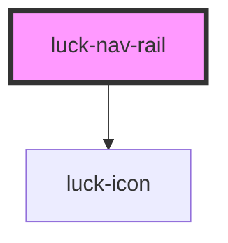

# luck-nav-rail

<!-- Auto Generated Below -->

## Overview

Trilho de navegação de primeiro nível: ícone (20 px) e rótulo curto por seção do produto. A seção aberta
leva `aria-current="page"` e o traço âmbar. Com `orientation="auto"`, o trilho é vertical e vira barra
horizontal em telas de até 700 px; `vertical` e `horizontal` fixam o arranjo.

Para navegação SPA, chame `preventDefault()` em `luckNavigate` e roteie você mesmo.

## Properties

| Property      | Attribute     | Description                                                                     | Type                                   | Default                 |
| ------------- | ------------- | ------------------------------------------------------------------------------- | -------------------------------------- | ----------------------- |
| `active`      | `active`      | `value` (ou `href`) da seção aberta.                                            | `string \| undefined`                  | `undefined`             |
| `items`       | `items`       | Seções: `[{ label, href, icon?, value? }]`. Via atributo, em JSON.              | `NavRailItem[] \| string`              | `[]`                    |
| `label`       | `label`       | Nome acessível do `<nav>`; deve diferir do nome de outras navegações da página. | `string`                               | `"Navegação principal"` |
| `orientation` | `orientation` | `auto` é vertical e vira horizontal em telas de até 700 px.                     | `"auto" \| "horizontal" \| "vertical"` | `"auto"`                |

## Events

| Event          | Description                                                                    | Type                                                          |
| -------------- | ------------------------------------------------------------------------------ | ------------------------------------------------------------- |
| `luckNavigate` | Clique em uma seção. Cancelável: `preventDefault()` impede a navegação nativa. | `CustomEvent<{ value: string; href?: string \| undefined; }>` |

## Slots

| Slot      | Description                                                                    |
| --------- | ------------------------------------------------------------------------------ |
| `"end"`   | Ações no pé do trilho vertical, como busca e conta (some na barra horizontal). |
| `"start"` | Marca ou atalho no topo do trilho vertical (some na barra horizontal).         |

## Shadow Parts

| Part     | Description |
| -------- | ----------- |
| `"item"` | Cada link.  |
| `"rail"` | O `<nav>`.  |

## Dependencies

### Depends on

- [luck-icon](../luck-icon)

### Graph

----------------------------------------------

