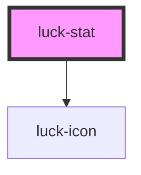

# luck-stat

<!-- Auto Generated Below -->

## Overview

Métrica em destaque: título curto com ícone Lucide, número com unidade e legenda. Com `href`, o bloco do
título à legenda vira um link só, e o nome acessível junta título, número, unidade e legenda na ordem de
leitura; destinos que não sejam caminho relativo, `http` ou `https` são descartados. `pending` marca o que
ainda não existe (borda tracejada, número esmaecido).

## Properties

| Property               | Attribute | Description                                              | Type                  | Default     |
| ---------------------- | --------- | -------------------------------------------------------- | --------------------- | ----------- |
| `caption`              | `caption` | Legenda abaixo do valor.                                 | `string`              | `""`        |
| `heading` _(required)_ | `heading` |                                                          | `string`              | `undefined` |
| `href`                 | `href`    | Destino da métrica: caminho relativo, `http` ou `https`. | `string \| undefined` | `undefined` |
| `icon`                 | `icon`    | Ícone Lucide antes do título.                            | `string \| undefined` | `undefined` |
| `pending`              | `pending` | Marca uma métrica que ainda não está disponível.         | `boolean`             | `false`     |
| `unit`                 | `unit`    | Unidade depois do valor (ex.: `projetos`).               | `string`              | `""`        |
| `value`                | `value`   | Número ou valor principal, já formatado.                 | `string`              | `""`        |

## Events

| Event      | Description                                                                              | Type                             |
| ---------- | ---------------------------------------------------------------------------------------- | -------------------------------- |
| `luckOpen` | Clique no link. Cancelável: `preventDefault()` impede a navegação (ex.: roteamento SPA). | `CustomEvent<{ href: string; }>` |

## Slots

| Slot      | Description                                                            |
| --------- | ---------------------------------------------------------------------- |
|           | Conteúdo extra abaixo da métrica, fora do link (ex.: um `luck-meter`). |
| `"badge"` | Selo à direita do título (ex.: um `luck-badge`).                       |

## Shadow Parts

| Part     | Description                                         |
| -------- | --------------------------------------------------- |
| `"card"` | O bloco da métrica (`<a>` com `href`, `
` sem). |

## Dependencies

### Depends on

- [luck-icon](../luck-icon)

### Graph

----------------------------------------------

